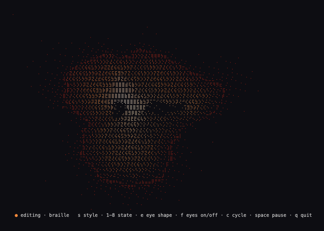
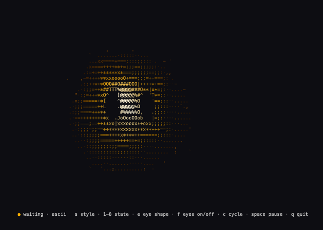
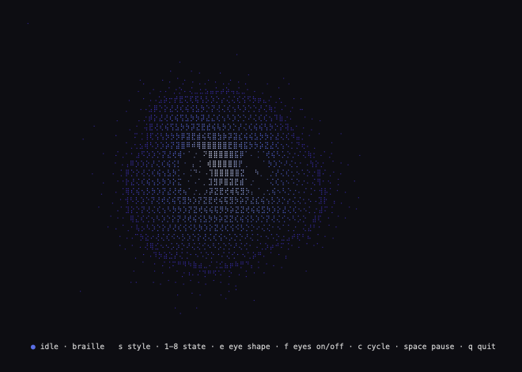
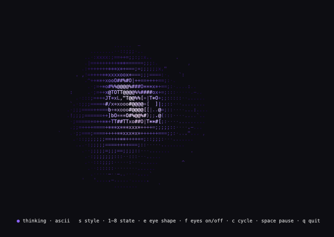

<h1 align="center">lumiases</h1>

<p align="center">Une orbe vivante qui regarde Claude Code travailler, pour que vous n'ayez pas à le faire.</p>

<p align="center"><sub>prototype · Go 1.22+, zéro dépendance · macOS · MIT</sub></p>

<p align="center">
  <a href="#fonctionnalités">Fonctionnalités</a> ·
  <a href="#installation">Installation</a> ·
  <a href="#utilisation">Utilisation</a> ·
  <a href="#suivre-claude-code">Suivre Claude Code</a> ·
  <a href="#mode-statue">Mode statue</a> ·
  <a href="#développement">Développement</a> ·
  <a href="README.md">English</a>
</p>

<table align="center">
  <tr>
    <td align="center"><br><sub>Braille, editing</sub></td>
    <td align="center"><br><sub>ASCII, waiting</sub></td>
  </tr>
  <tr>
    <td align="center"><br><sub>Braille, idle, yeux void</sub></td>
    <td align="center"><br><sub>ASCII, thinking, lunettes</sub></td>
  </tr>
</table>

lumiases dessine une orbe de matière vivante dans un panneau de terminal,
pensée pour se placer à côté d'une session Claude Code : sa forme, sa vitesse
et ses couleurs changent selon ce que fait Claude. Pour l'instant c'est le
moteur de rendu seul, qui fait défiler ses états ou se pilote au clavier ; le
branchement sur les hooks de Claude Code vient ensuite.

## Fonctionnalités

- **Cinq rendus.** Braille (8 points par cellule, tramés en poussière fine) et
  ASCII, où chaque caractère est choisi pour sa forme (`"` quand le haut est
  éclairé, `(` pour le côté gauche, `/` sur une diagonale) : les contours à
  l'intérieur de l'image survivent ; et pixel, quatre pixels par cellule en
  quarts de bloc, pour des dégradés lisses ; octant, les huit points par
  cellule du braille en blocs pleins (une police récente ou un terminal qui
  dessine les blocs lui-même, comme Ghostty) ; et image, une vraie image pour
  les terminaux qui savent en afficher (Ghostty, kitty, WezTerm avec
  `enable_kitty_graphics = true`).
- **Huit états.** idle, thinking, reading, editing, running, waiting, error et
  done ont chacun leur contour, leur vitesse, leur palette et leur dégradé ;
  l'orbe passe de l'un à l'autre en 300 ms environ.
- **Des yeux, en cinq formes.** round, slits, void, glasses et shades, creusés
  dans la matière et qui bougent avec elle, avec une expression par état : ils
  se plissent pendant la réflexion, balaient pendant la lecture, s'écarquillent
  en attente, se froncent sur une erreur et sourient à la fin.
- **Mode statue.** La matière coule sur la photo d'une statue : la tête
  respire et se balance, et chaque état ajoute son effet (fumée qui monte,
  bande de lumière qui scanne, glitchs, ondes, reflet).
- **Un petit binaire.** Bibliothèque standard de Go uniquement, environ 30
  images par seconde sur un panneau de 200×60.

## Installation

Pas encore de release. Avec Go 1.22 ou plus récent :

```
go install github.com/te-o-o-o/lumiases@latest
```

ou depuis un clone : `go run .`

## Utilisation

```
lumiases                      # braille, change d'état toutes les 4 s
lumiases -style ascii
lumiases -follow              # suit Claude Code (voir plus bas)
lumiases -state thinking      # garde un seul état
lumiases -eyes glasses        # round, slits, void, glasses, shades
```

| Touche | Effet |
|---|---|
| `s` | passe du braille à l'ASCII, au pixel, à l'octant puis à l'image |
| `1`–`8` | choisit un état |
| `c` | relance le défilement des états |
| `h` | tête suivante, puis retour à l'orbe (mode statue) |
| `r` | fait tourner la tête (mode statue) |
| `e` | forme d'yeux suivante |
| `f` | affiche ou masque les yeux |
| espace | pause |
| `q` | quitte |

L'image remplit le panneau et suit sa taille. Une police plus petite dans ce
panneau donne plus de cellules, donc une orbe plus fine.

## Suivre Claude Code

Claude Code lance `lumiases hook` à chaque événement ; le hook écrit l'état
qu'il en déduit dans un petit fichier, et `lumiases -follow`, dans un panneau à
côté de Claude, le joue. Installez le binaire (`go install .` depuis un clone
le met dans `~/go/bin`, qui doit être dans votre `PATH`), puis ajoutez les
hooks à `~/.claude/settings.json`, ou au `.claude/settings.json` d'un projet :

```json
{
  "hooks": {
    "SessionStart":       [{ "hooks": [{ "type": "command", "command": "lumiases hook" }] }],
    "UserPromptSubmit":   [{ "hooks": [{ "type": "command", "command": "lumiases hook" }] }],
    "PreToolUse":         [{ "matcher": "*", "hooks": [{ "type": "command", "command": "lumiases hook" }] }],
    "PostToolUse":        [{ "matcher": "*", "hooks": [{ "type": "command", "command": "lumiases hook" }] }],
    "PostToolUseFailure": [{ "matcher": "*", "hooks": [{ "type": "command", "command": "lumiases hook" }] }],
    "Notification":       [{ "hooks": [{ "type": "command", "command": "lumiases hook" }] }],
    "Stop":               [{ "hooks": [{ "type": "command", "command": "lumiases hook" }] }],
    "SessionEnd":         [{ "hooks": [{ "type": "command", "command": "lumiases hook" }] }]
  }
}
```

| Claude | lumiases |
|---|---|
| lit, cherche, navigue | reading |
| modifie ou écrit un fichier | editing |
| lance une commande ou un autre outil | running |
| reçoit votre message, entre deux outils, lance un sous-agent | thinking |
| vous attend (permission, question) | waiting |
| un outil échoue | error |
| termine sa réponse | done, puis idle après 5 s |

Avec plusieurs sessions ouvertes, le panneau suit le dernier événement, quelle
que soit la session.

## Mode statue

```
lumiases heads/*.png                         # toutes les têtes, h passe de l'une à l'autre et à l'orbe
lumiases -face buste.png -style ascii
lumiases -face statue.jpg -crop 0.2,0.1,0.82,0.66
```

Donnez des photos de statues avec `-face` (répétable) ou après les options ;
`h` passe d'une tête à la suivante puis revient à l'orbe, `r` fait tourner la
tête. Le mieux est un PNG détouré (macOS : Aperçu ou Photos, « Supprimer
l'arrière-plan », ou `swift tools/cutout.swift photo.jpg heads/buste.png 0 0 1 0.7`
pour détourer et garder les 70 % du haut) ; sans transparence, la statue est reconnue par sa couleur,
ce qui ne marche que pour de la pierre chaude sur du feuillage. `-crop` garde
une partie de chaque image, en fractions `x0,y0,x1,y1`. Aucune photo n'est
fournie avec lumiases : les images en accès libre du Metropolitan Museum (CC0)
sont une bonne source.

## Développement

```
go vet ./... && go test ./...
go run . -style ascii
COLUMNS=110 LINES=50 go run . -state error -frames 45 < /dev/null > frame.ansi   # capturer des images sans terminal
```

Décisions, impasses et ce qui a été vérifié sur quel système :
[docs/notes.fr.md](docs/notes.fr.md).

## Licence

[MIT](LICENSE)
